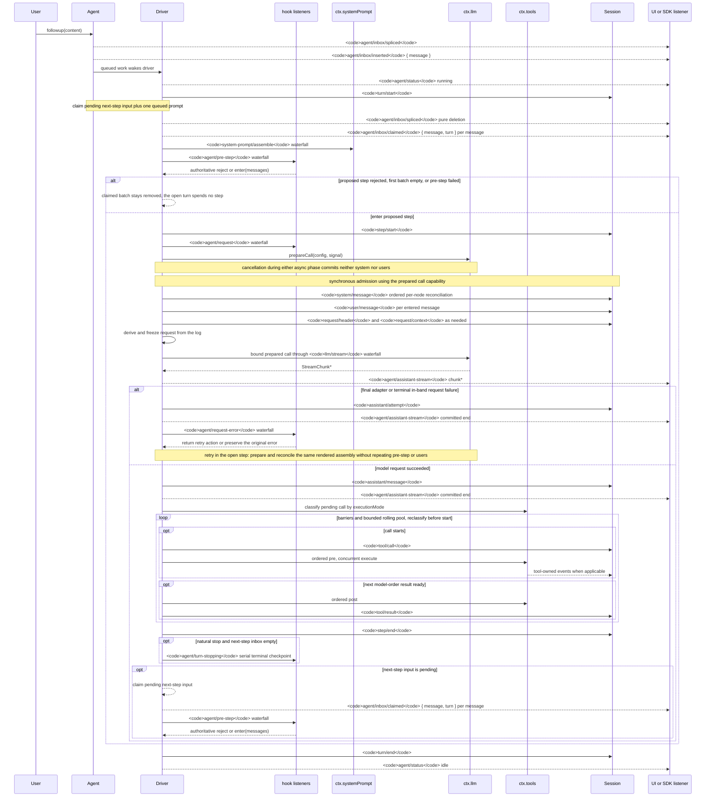

<!-- Generated by scripts/gen-doc-graphs.ts - do not edit by hand.
     Run `pnpm run gen-doc-graphs` to regenerate. -->

# Lifecycle von Agent-Turn und -Step

Diese Sequenz ist der visuelle Begleiter zu [architecture.md](architecture.md#turn-flow). Sie hält dauerhafte Replay-Fakten auf `session/event` und Live-Steuerung/-Status auf `agent/*`.

Das Event `assistant/message` zeichnet jeden erfolgreichen Provider-Aufruf auf, einschließlich inhaltsloser und `max-tokens`-Abschlüsse, und bettet den exakten kompakten, mit Zeitstempeln versehenen Stream ein. Leerer Inhalt bleibt aus der abgeleiteten Historie heraus. Ein fehlgeschlagener, wiederholter, abgebrochener oder mit Stream-Fehler behafteter Versuch, der die Settlement ohne Oberflächennachricht erreicht, zeichnet seinen Stream als `assistant/attempt` auf. Live-Chunk-Frames von `agent/assistant-stream` sind transient; Replay liest entweder das dauerhafte Settlement, und ein harter Prozessverlust vor der Settlement hinterlässt keinen dauerhaften Attempt-Stream.

`dsh-compaction-basic` verwendet `agent/pre-step` für Druck vor der Request-Ableitung und `agent/request-error` nur für kanonischen Context-Overflow. Sobald einer der beiden Auslöser zutrifft, läuft optionales Pruning von Tool-Results vor der Summary-Auswahl. Die Wiederherstellung läuft innerhalb des offenen Steps und wiederholt nur dann, wenn Pruning oder Summarization die Surface-Replacement-Generation voranbringt; andernfalls bleibt der ursprüngliche Request-Fehler maßgeblich. Jede Wiederholung bereitet ihren Aufruf vor und gleicht die beibehaltene gerenderte Assembly ab, bevor die Request-Ableitung erfolgt, ohne Assembly, Pre-Step oder User-Admission zu wiederholen.

Die zurückgegebene Entscheidung von `agent/pre-step` ist maßgeblich; Listener, die `next()` umhüllen, bewahren nachgelagerte Nachrichten und `startsRequestSeries`, sofern die Ersetzung nicht beabsichtigt ist. Steering und injizierter Context laufen durch denselben Waterfall, nachdem eine spätere Claim-Operation ihren Next-Step-Batch übernommen hat.

SDK-Nutzer, die replayfähige Transkript-Daten benötigen, sollten `session/event` konsumieren; `agent/*` ist die Live-Koordinations-API für Queue/Status, Prompt-Interception, Request-Konstruktion, Steering, Continuation und Fehler.

Maintenance-Modus: kuratiertes Mermaid-Sequenzdiagramm; exakte Event-Signaturen stehen im generierten Cordis-Katalog.
