<!-- Erzeugt von scripts/gen-doc-graphs.ts - nicht von Hand bearbeiten.
     Mit `pnpm run gen-doc-graphs` neu erzeugen. -->

# Tool-Ausführungs-Pipeline

Dieses Diagramm zeigt, wo Policy, Hooks, Sandboxing, Filesystem-Wächter, Ergebnisumschreibung, Beobachtung des Endergebnisses und UI-Rendering laufen, ohne den Loop zu ändern. Der Waterfall `tools/pre-execute` läuft zuerst, danach laufen monotone Wächter, und die Waterfalls `tools/execute` und `tools/post-execute` folgen; die drei Waterfalls können einen Aufruf umformen. Das von der Definition besessene `projectContent` installiert vorbereiteten Inhalt vor post-execute; `finalizeContent` und `tools/result` laufen danach.

```mermaid
flowchart TD
  model["Assistant message contains tool-call block"]
  toolCall["Session event: <code>tool/call</code><br/>logged before execution"]
  presentCall["UI pending card<br/>presentCall(args)"]
  pre["<code>tools/pre-execute</code> waterfall<br/>hooks, permission, sandbox"]
  guards["Registered monotonic guards<br/>deny or abstain; identity protected"]
  denied["denied or approval refused<br/>tool body skipped"]
  approval["<code>ctx.approval</code> one-shot prompt<br/>absent or unanswerable: deny"]
  around["<code>tools/execute</code> waterfall<br/>timeout, retry, metrics (around dispatch)"]
  toolBody["Registered tool execute() body"]
  fsGate["<code>fs/write-intent</code> or <code>fs/edit-intent</code><br/>tool-fs mutations only"]
  owned["Tool-owned session events<br/><code>todo/write</code>, <code>fs/observed</code>, <code>hook/invoked</code>, <code>hook/result</code>, <code>tool/ptc-dispatch</code>"]
  project["ToolDefinition.projectContent<br/>execution-prepared text and images"]
  post["<code>tools/post-execute</code> waterfall<br/>accept, block, replace, add context"]
  normalized["Registry outer normalization<br/>pipeline/result snapshot throws become isError"]
  finalize["ToolDefinition.finalizeContent<br/>last content-only invariant"]
  final["<code>tools/result</code> synchronous notification<br/>frozen authoritative outcome"]
  context["Active-batch additionalContexts FIFO<br/>injected user/message after recorded tool results"]
  toolResult["Session event: <code>tool/result</code><br/>single model-facing outcome"]
  allResults["Tool batch settled<br/>recorded tool/result events complete"]
  presentResult["UI completed card<br/>presentResult(args, result)"]
  model --> toolCall
  toolCall --> presentCall
  toolCall --> pre
  pre -->|allow| guards
  guards -->|allow| around
  guards -->|deny| denied
  guards -.->|throw| normalized
  around --> toolBody
  pre -->|deny| denied
  pre -->|ask| approval
  approval -->|allowed-once| guards
  approval -->|rejected, cancelled, unavailable| denied
  approval -.->|throw| normalized
  denied --> project
  pre -.->|throw| normalized
  toolBody --> fsGate
  fsGate --> toolBody
  toolBody --> owned
  toolBody --> around
  around --> project
  project --> post
  project -.->|throw| normalized
  around -.->|wrapper throws| normalized
  post -.->|throw| normalized
  post --> finalize
  normalized --> finalize
  finalize --> final
  final --> toolResult
  toolResult --> presentResult
  toolResult --> allResults
  allResults --> context
```

Filesystem-Prüfungen nach dem Muster Read-before-edit bleiben unterhalb von `tool-fs` auf `fs/*`-Ereignissen. Die generischen Pre-/Post-Waterfalls beherbergen Hooks und Freigabe-Policy; `ctx.approval` löst Anfragen vor den monotonen Wächtern auf, und Owner-Policy, die nicht umsortiert werden darf, bleibt ein registrierter Wächter. Belange rund um den Dispatch wie Timeouts umhüllen `tools/execute`. Die Registry erstellt einen verlustfreien Snapshot des Kandidatenergebnisses und normalisiert einen Snapshot-Fehler, bevor der gesnapshottete `finalizeContent`-Callback der sichtbaren Definition seine synchrone, rein inhaltsbezogene Invariante durchsetzt. `tools/result` beobachtet dann das unveränderliche, verlustfreie JSON-Ergebnis. So können Hooks Tool-Familien überspannen, ohne die Tools an einen einzigen Policy-Service zu koppeln. Der PTC-Modus schickt sowohl den reservierten `run_code`-Transport als auch seine serialisierten Sub-Aufrufe durch die Pipeline; Sub-Aufrufe tragen das Eltern-Token, protokollieren `tool/ptc-dispatch`, geben Ablehnungen als Binding-Verwerfungen zurück und lassen `additionalContexts` weg, um die Nachbarschaft von Aufruf und Ergebnis zu wahren.

Wartungsmodus: kuratierter Mermaid-Flow; exakte Tool-Schemas und Event-Signaturen liegen in generierten Katalogen.
