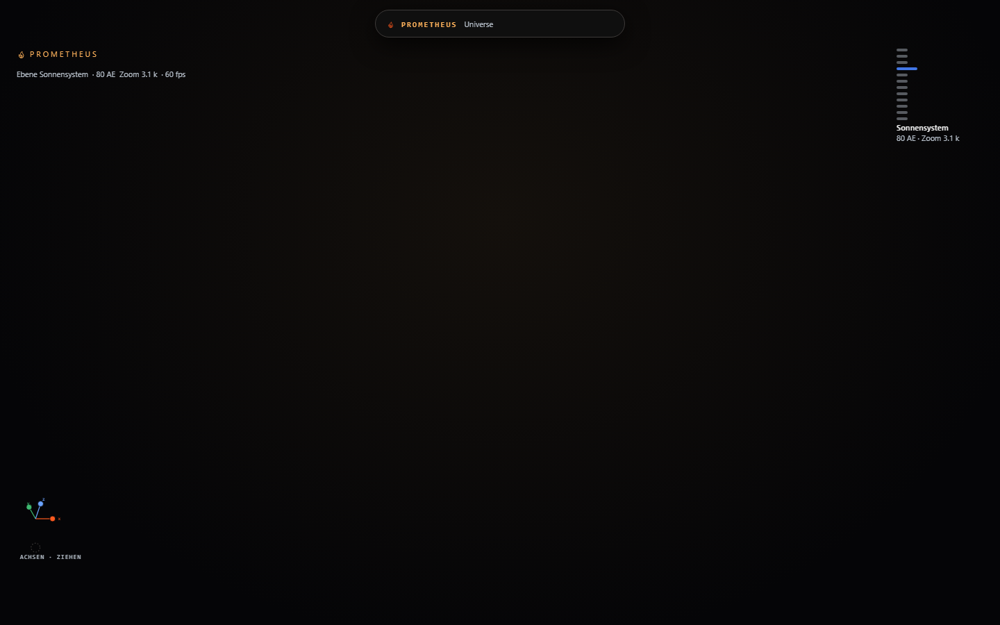

# Die Zeichen — gezeichnet statt geschrieben

> **Stand:** 15.10.2026 · **Auftrag:** *„kannst du ein assets erstellen als SVG? emoji sieht schon
> scheisse aus und umprofessionell — ein komplette assets kannst es gerne als GIthub rein tun also ein
> eigenes projekt oder implementierung oder so, oder die vorhandene ordner. passend für ein Moderne
> Harness, Suche dir theme zur Prometheus Mythologie oder legende idk"*
>
> **Was hier belegt wird:** was gebaut wurde, **warum** Schriftzeichen das Problem waren, was gemessen
> ist — und was offen blieb.

---

## 1. Der Befund, in einem Bild

| | vorher | nachher |
|---|---|---|
| Marke der Kopfzeile | `◆ PROMETHEUS` |  — Flamme + `PROMETHEUS` |
| Insel-Eintrag Ort | `# Sonnensystem` | gezeichnete Bahn mit Körper |
| Gruppe | `⌥ objekte` | gezeichnete Kugel + `objekte` |
| Schliessen | `✕` | gezeichnetes Kreuz |
| Terminal | `❯` | gezeichneter Winkel mit Strich |

Die Tafel aller 33 Zeichen: **`packages/assets/icons/svg/index.html`** — als Bild
[`img/zeichen-tafel.png`](img/zeichen-tafel.png). Der Bildschirm mit dem Einstellungsdialog (Zeichen
im Knopf und in der Insel): [`img/zeichen-einstellungen.png`](img/zeichen-einstellungen.png).

**Warum Schriftzeichen das Problem waren** — drei Gründe, und keiner ist Geschmack:

1. **Ein Schriftzeichen ist eine Schriftart.** Wie `◆` aussieht, entscheidet der Rechner des
   Betrachters. `▤` fehlt in manchen Schriften ganz — dann steht dort ein **Platzhalterkästchen**.
2. **Ein Schriftzeichen hat keine Bedeutung.** `#` heisst „Nummer", nicht „Ort"; `~` heisst
   „ungefähr", nicht „Körper". Vor `EINSTELLUNGEN` stand `⚙` — eine Übersetzungshilfe für ein Wort,
   das schon dasteht.
3. **Ein Schriftzeichen folgt keiner Linie.** Mal Vollton, mal Strich, mal 10 px breit, mal 14. Eine
   Reihe davon sieht aus wie gewachsen, nicht wie gebaut.

---

## 2. Was gebaut ist

### 2.1 Das Paket `packages/assets/icons`

| Datei | Was |
|---|---|
| `src/shapes.ts` | **die Quelle**: 33 Zeichen als Geometrie, dazu die Rechenhelfer (Punkt auf Kreis und Ellipse, Zahnrad, Strahlenkranz, Bogen) |
| `src/index.ts` | die Schnittstelle: `iconMarkup`, `iconElement`, `spriteMarkup`, `iconFile`, `iconId` |
| `build.mjs` | schreibt die Dateien: `svg/<name>.svg`, `svg/sprite.svg`, `svg/index.html`, `svg/README.md` — und `--pruefen` vergleicht sie mit der Quelle |
| `tests/icons.test.ts` | 16 Prüfungen (siehe §3.3) |
| `svg/` | das **Ergebnis**: 33 Einzeldateien, ein Sprite, ein Übersichtsblatt |

**33 Zeichen**, in vier Gruppen:

* **Das Thema (5):** `prometheus` (die Flamme — die Marke), `torch`, `vessel`, `chain`, `anvil`.
* **Navigation (18):** `orbit`, `chat`, `reset-view`, `settings`, `gear`, `close`, vier `chevron-`,
  `plus`, `prompt`, `panels`, `layers`, `search`.
* **Der Himmel (10):** `place`, `constellation`, `stack`, `solar-system`, `galaxy`, `cluster`, `star`,
  `planet`, `object`, `code-file`.
* **Der Zustand (3):** `pulse`, `spark`, `chip`.

Die Mythologie ist **Thema, nicht Vollständigkeit**: fünf Zeichen tragen sie (Feuer, Fackel, Gefäß,
Kette, Amboss), die übrigen sind Werkzeug. Ein Satz, der nur aus Mythen bestünde, wäre ein Poster und
keine Oberfläche.

### 2.2 Der Einbau in die Welt

| Ort | vorher | nachher |
|---|---|---|
| Marke der Kopfzeile (`main.ts`) | `◆ PROMETHEUS` | `iconMarkup('prometheus')` + Text |
| Marke der Pille | grüner Punkt | **dieselbe** Flamme (zwei Marken in einem Bild waren eine zu viel) |
| Insel-Einträge (`ISLAND_GROUPS`) | `sigil: '#'` | `icon: 'place'` — **typisiert** (`IconName`), ein Tippfehler fällt beim Typlauf auf |
| Gruppenüberschriften | kein Zeichen | je Gruppe eines (`place`, `object`, `gear`, `layers`) |
| Panel-Zeile | `▸` / `▾` | `chevron-right` / `chevron-down` |
| Schliessen (6 Stellen) | `✕` | `close` |
| Zurück im Einstellungsbildschirm | `↺` | `chevron-left` |
| Abgesteckte Panels | `+ Titel` | `plus` + `Titel` |
| Terminal | `❯` | `prompt` — vor dem Feld **und** vor jeder Eingabezeile |
| Sprachpakete | `'⌥ objekte'` | `'objekte'` — **das Zeichen gehört nicht in einen Satz** |

### 2.3 Das App-Zeichen

`apps/universe/public/favicon.svg` — dieselbe Flamme in `#ff9d3f`, eingebunden in `index.html`. Die
Datei ist **erzeugt** (`tools/write-favicon.mjs` aus `src/app-icon.ts`), weil eine von Hand
geschriebene Datei eine **zweite Zeichnung** derselben Marke wäre. `tests/favicon.test.ts` hält beide
zusammen.

---

## 3. Die Befunde — was die Prüfungen gefunden haben

**Keiner dieser sieben Befunde kam vom Hinsehen.** Sie kamen von einer Zählung, einer Rechnung oder
einem Bild — und genau dafür stehen sie hier.

### 3.1 Die halbe Umstellung — und wie sie auffiel

Der Umbau stellte **die Anzeige** um (`sigil: '#'` → `icon: 'place'`) und ließ die **Beschriftungen**
stehen: `'island.group.objects': '⌥ objekte'`. Im Bild stand danach eine gezeichnete Kugel **und** ein
`⌥` daneben — und in der Insel sah das nach Absicht aus.

**Gefunden hat es eine Zählung im Browser**, nicht das Auge:

```js
for (const el of document.querySelectorAll('*'))
  for (const k of el.childNodes)
    if (k.nodeType === 3 && /[◆▤◉⟲⌥⚙✕❯▸▾↺]/.test(k.nodeValue ?? '')) …
```

Ergebnis: `⌥ objekte`, `⚙ einstellungen`, `◉ ansichten`, `▤ panels`, und — beim zweiten Lauf — ein
`❯`, das das **Terminal** vor jede bestätigte Eingabe schrieb. Dieselbe Prüfung läuft jetzt ohne
Browser als `apps/universe/tests/icons.test.ts` (Sprachpakete + Quelltext ohne Kommentare).

### 3.2 `×` ist ein Malzeichen, kein Zeichen

Der erste Anlauf der neuen Prüfung hatte `×` in die Liste der verbotenen Zeichen aufgenommen. Sie
meldete vier Stellen:

```
src/builtin-plugins.ts: `Die Matrix (${view.dimension}×${view.dimension}, `
src/main.ts:            screen: `${window.innerWidth}×${window.innerHeight}`
src/rotation.ts:        new Error(`Formen passen nicht: ${n}×${outer}`)
```

Alle vier sind **richtig**: ein Malzeichen steht in einer Zahl, nicht vor einer Beschriftung. Eine
Liste, die Typografie und Bild nicht unterscheidet, zwingt den nächsten, richtigen Text zu ändern — und
wird dann abgeschaltet. `×` steht deshalb **nicht** in der Liste, und der Grund steht daneben.

### 3.3 Zwei Zeichen, eine Zeichnung — und der Prüfer als Täter

| Befund | Wie er auffiel |
|---|---|
| `stack` und `layers` malten **beide** einen Stapel Rauten | Prüfung auf **doppelte Körper** (im Blatt sah es nach Absicht aus) |
| Die Körper auf `orbit`s Bahn waren mit `r = 1,5` **unter dem Strich der Bahn** verschwunden | dieselbe Zählung: ein Ring und sonst nichts |
| **`torch` sah aus wie ein Kelch**, `vessel` wie ein Weinglas, `chain` wie eine „8" | das **Bild**: `svg/index.html` gerendert und angesehen |
| Der Prüfer selbst las `-.6` nicht als Zahl (`-?\d*\.?\d+` läßt sie durchfallen) | die Rasterprüfung war rot — schuld war nicht das Zeichen, sondern ihr Parser |
| Der Prüfer las `c0-3.4-2.4…-.6-1.3` als **zwei** Befehle statt eines Befehls mit zwei Stücken | dieselbe Stelle: die Wiederholung eines Befehls ohne Buchstaben (`M`→`L` nach der Spezifikation) |
| Die Prüfung „ohne Größe" schlug bei `stroke-width` und bei `<rect width>` an | sie suchte im **ganzen** Markup statt in der Wurzelmarke |

*Merksatz:* **eine Prüfung, die falsch Alarm schlägt, wird abgeschaltet — und dann prüft sie nichts
mehr.** Drei der sechs Einträge oben waren Fehler des Prüfers, nicht der Zeichen; sie sind behoben und
der Grund steht im Code.

### 3.4 Der Schliessen-Knopf hatte keinen Text mehr

`settings-modal.test.ts` fand den Knopf über seinen Inhalt (`vollerText === '✕'`). Ein gezeichnetes
Zeichen hat keinen Text. Die Antwort ist **kein** Vergleich der Zeichnung (der bräche beim nächsten
Zeichenwechsel), sondern ein **stabiler Griff** — `data-close="settings"`, dasselbe Verfahren wie
`data-action` an den Insel-Einträgen. Und die Aussage „der Knopf ist nicht leer" gehört **nicht** in
diesen Test: sein Knoten baut `innerHTML` nicht nach, er hätte den Stub geprüft statt der Anwendung
(genau davor warnt der Dateikopf dieser Prüfung).

### 3.5 Die Zelle war 12 px breit, das Zeichen 15

`.isl .isitem .ih { width: 12px }` hielt den Platz **eines Schriftzeichens**. Gemessen im Browser:

```
ihBreite: 15, ueberlauf: 0, svg: [15, 15], vollstaendig: true     ← nachher
ihBreite: 12, ueberlauf: 3                                        ← vorher
```

Die Zeile wurde davon **nicht** höher, aber das Zeichen schob sich 3 px in den Abstand zur
Beschriftung. Bei einem anderen Zeichen hätte das nach Absicht ausgesehen.

### 3.6 Die Zeichen kosten keinen Platz

Die Sorge war berechtigt: eine Insel, in der jede Zeile ein Bild trägt, wird höher — und Höhe ist in
einer Insel mit 280 px das knappe Gut. **Gemessen** (Zeichen im Browser ausgeblendet und dieselbe
Zeile noch einmal gemessen):

```
.isl .isitem   33 px mit Zeichen · 33 px ohne · Zuwachs 0 px
.isl .grp      37 px mit Zeichen · 37 px ohne · Zuwachs 0 px
```

Der Grund: das alte Schriftzeichen füllte die Zeile schon aus. Die Liste zeigt deshalb **genau so
viele Einträge** wie vorher.

### 3.7 Und ein offener Punkt wurde dabei geschlossen

`docs/status/umschalter-marke.md` §4 sagt bis heute: *„Kein Browser auf diesem Rechner.
`chrome-devtools` meldet ‚Could not find Google Chrome executable'."* Das stimmt für Chrome — aber
**Brave ist installiert** (`C:\Program Files\BraveSoftware\Brave-Browser\Application\brave.exe`), und
es ist ein Chromium: mit `--headless=new --remote-debugging-port=9223` nimmt `apps/universe/tools/shot.js`
es ohne eine Zeile Änderung. Die Bilder dieses Dokuments sind damit **echte Bilder**, und die
Daten-Adresse des Umschalters (`/universe/`, kurz, ohne Zusätze) ist am lebenden Rechner nachsehbar.

---

## 4. Nachweise — gemessen, nicht behauptet

| Prüfung | Ergebnis |
|---|---|
| `bun test` in `packages/assets/icons` | **16 pass · 0 fail**, 618 Zusicherungen |
| `bun run typecheck` in `packages/assets/icons` | **0 Fehler** |
| `bun build.mjs --pruefen` | **36 Dateien** stimmen mit `src/shapes.ts` überein |
| `bun test` in `apps/universe` | **266 pass · 0 fail**, 4027 Zusicherungen, 26 Dateien |
| `bun run typecheck` in `apps/universe` | **0 Fehler** |
| `vite build` | **exit 0** — `dist/assets/index-mm0Xl017.js` **697,23 kB** (vorher 688,10), CSS 46,29 kB (vorher 45,66) |
| `bun tools/write-favicon.mjs --pruefen` | `public/favicon.svg` stimmt mit dem Zeichensatz überein |
| Welt am laufenden Rechner | `/universe/` **200**, 1 Prozess — siehe [welt-ein-port.md](welt-ein-port.md) |

**Im Browser gemessen** (Brave, kopflos, CDP — `apps/universe/tools/shot.js` und eine Sonde):

| Frage | Antwort |
|---|---|
| Wie viele gezeichnete Zeichen stehen auf dem Bildschirm? | **33** `svg.pmh-icon` (Insel offen, Welt) |
| Steht noch ein Schriftzeichen im Dokument? | **keines** — die Textknoten-Zählung findet 0 Treffer |
| Hat jede Stelle ein Zeichen? | `.ih`, `.sigil`, `.x`, `.wm`, `.grp`, `.dockbtn`, `.mini` → **`ohneZeichen: []`** |
| Die abgesteckten Panels | **12** `plus`-Zeichen in den Dock-Knöpfen |
| Der Schliessen-Knopf des Einstellungsbildschirms | `{ hatSvg: true, daten: 'settings' }` |
| Zellbreite / Überlauf | **15 px / 0** |
| Zeilenhöhen | **unverändert** (§3.6) |

---

## 5. Was **nicht** gemessen ist — offen und benannt

1. **Das Favicon im Reiter.** Es ist eingebunden und die Datei stimmt mit dem Zeichensatz überein —
   aber ob der Reiter es **zeigt**, sagt nur ein Blick auf einen echten Browserreiter. Ein kopfloses
   Fenster hat keinen.
2. **Das Terminal-Zeichen im Bild.** Der Prompt ist an derselben Stelle gebaut wie die übrigen
   (Typlauf, Namensprüfung, Übersichtsblatt) — aber das Panel ließ sich in der Messung nicht öffnen
   (die Panelliste liegt hinter dem Rollbalken der Insel, und `openPanel` griff aus der Sonde nicht).
   Das Zeichen ist damit **gebaut**, nicht **gesehen**.
3. **Die 3D-Welt zeichnet in diesem kopflosen Browser nichts.** WebGL 2.0 ist da
   (`WebKit WebGL`, SwiftShader), die Fläche ist da (1440 × 900), die Beschriftungen und das
   Achsenkreuz werden gezeichnet — die Körper nicht. **Nicht untersucht.** Das ist ein eigener Befund
   und gehört nicht in dieses Dokument; er steht hier, damit ihn niemand für einen Fehler der Zeichen
   hält.
4. **Die Zeichen sind nicht in git eingestuft.** Es wurde **nichts** gestaged — wie bei allen
   Änderungen dieser Sitzung.
5. **Kein Vergleich mit einem fertigen Zeichensatz.** Die Formen sind hier gezeichnet, nicht
   eingekauft: keine fremde Lizenz, keine fremde Linienführung — aber auch keine erprobte
   Gewichtsverteilung. Wer einen großen Satz braucht (Dateitypen, Marken, Flaggen), nimmt besser einen
   vorhandenen.

---

## 6. Wie man es nachfährt

```powershell
$BUN = "$env:USERPROFILE\.bun\bin\bun.exe"

# 1. Den Zeichensatz prüfen, bauen, ansehen
cd packages\assets\icons
& $BUN test ; & $BUN run typecheck ; & $BUN build.mjs --pruefen
start svg\index.html            # das Übersichtsblatt

# 2. Die Welt prüfen (und bauen)
cd ..\..\apps\universe
& $BUN test ; & $BUN run typecheck ; & $BUN run build

# 3. Die Welt ansehen — mit echtem Browser, kopflos, über CDP
#    (Brave zuerst starten; Chrome gibt es auf diesem Rechner nicht)
start "" "C:\Program Files\BraveSoftware\Brave-Browser\Application\brave.exe" `
  --headless=new --remote-debugging-port=9223 --user-data-dir="$env:TEMP\pmh-brave" about:blank
& $BUN tools\shot.js "http://127.0.0.1:3081/universe/?room=icons" "$env:TEMP\welt.png"
```
